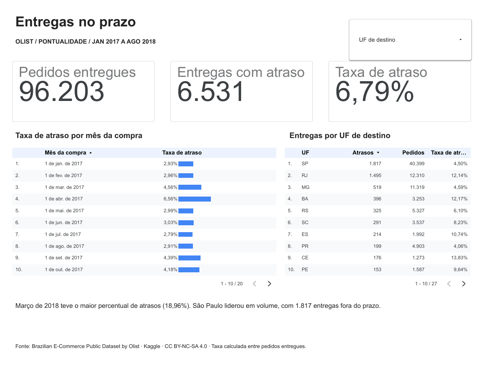

# Entregas no prazo

**Quais pedidos do e-commerce merecem acompanhamento prioritário já no momento da compra?**

Este projeto analisa a pontualidade das entregas da Olist e simula uma fila de revisão para a equipe de logística. O recorte vai de janeiro de 2017 a agosto de 2018 e considera pedidos com entrega observada. A análise usa dados públicos anonimizados.

## Dashboard

O painel tem duas páginas. **Pontualidade** compara o percentual mensal e os volumes por UF, com um filtro de destino. **Priorização** mostra os resultados da fila com cota diária no teste de abril a agosto de 2018. [Abrir o dashboard no Looker Studio](https://datastudio.google.com/reporting/80c45e1c-a6d3-44d3-9eb8-461eae12a532/page/eC9CG)

[](https://datastudio.google.com/reporting/80c45e1c-a6d3-44d3-9eb8-461eae12a532/page/eC9CG)

## Entregáveis

| Entregável | Conteúdo |
| --- | --- |
| [Problema e justificativa](docs/01-problema.md) | Contexto, pergunta, público e decisão operacional. |
| [Fontes e coleta](docs/02-fontes-e-coleta.md) | Origem, tabelas, licença e download reproduzível. |
| [Notebook de EDA e modelagem](notebooks/01-eda-e-modelagem.ipynb) | Limpeza, distribuições, tendências, associações e avaliação temporal. |
| [Script de análise](src/analise.py) | Preparação, modelo, métricas e exportação da fonte do painel. |
| [Relatório de insights](docs/03-insights.md) | Achados, interpretação, ações sugeridas e limitações. |
| [Fonte do dashboard](dashboard/dados_painel.csv) | Dados agregados. A taxa de atraso é a soma de atrasos dividida pela soma de pedidos. |

## Modelagem

O atraso ocorre quando a data da entrega é posterior à data prometida. A regressão logística usa destino, tipo de rota, prazo, momento da compra e características agregadas da cesta. Datas posteriores à compra e avaliações ficam reservadas à medição do desfecho e à EDA.

O treino usa compras de 2017 com entrega conhecida antes de janeiro de 2018. A validação usa compras de janeiro a março de 2018 com entrega conhecida antes de abril e define o limiar para um orçamento hipotético de 15% de alertas. Em compras de abril a agosto de 2018, comparamos esse limiar fixo com uma cota diária de até 15%.

## Conclusões

- **6,79%** dos 96.203 pedidos entregues chegaram depois da data prometida. Março de 2018 teve a maior taxa mensal, de **18,96%**.
- Entre os pedidos avaliados, **62,42%** dos atrasados receberam nota 1 ou 2, ante **9,25%** dos pedidos no prazo.
- No teste, uma fila com cota diária sinalizaria **14,76%** dos pedidos e capturaria **30,33%** dos atrasos. O limiar fixo sinalizaria **23,92%** dos pedidos. Para um piloto, a cota protege a capacidade de revisão.

## Reproduzir

Use Python 3.11. No PowerShell, a partir da raiz do repositório:

```powershell
python -m venv .venv
.\.venv\Scripts\python.exe -m pip install -r requirements.txt
New-Item -ItemType Directory -Force data/raw | Out-Null
curl.exe --fail --location "https://www.kaggle.com/api/v1/datasets/download/olistbr/brazilian-ecommerce?datasetVersionNumber=2" --output data/raw/olist-v2.zip
.\.venv\Scripts\python.exe -X utf8 -m src.analise
```

O script imprime a auditoria e as métricas e recria `dashboard/dados_painel.csv`. Para executar o notebook, selecione o ambiente `.venv` como kernel no seu editor Jupyter.

## Fonte

Brazilian E-Commerce Public Dataset by Olist, versão 2. A fonte indica a licença CC BY-NC-SA 4.0 para os dados. O CSV agregado é derivado dessa base para este projeto acadêmico. [Olist no Kaggle](https://www.kaggle.com/datasets/olistbr/brazilian-ecommerce)
